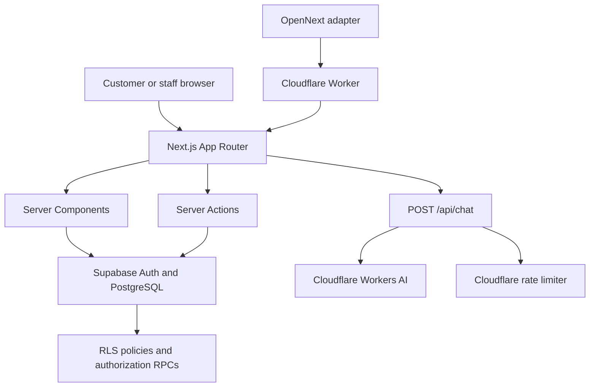

# Solenne

### A full-stack commerce platform for an artisan candle brand

Solenne is a full-stack e-commerce and store-operations platform built around an artisan candle brand. It combines a bilingual customer storefront, account and checkout flows, a role-aware administration dashboard, and an AI scent concierge.

The project is designed to demonstrate end-to-end product engineering: building customer-facing experiences while also handling the backend concerns behind them — data integrity, authorization, operational workflows, performance, and deployment architecture.

> **Project status:** Core storefront, account, order-management, inventory, product-management, customer-management, audit, and AI-assistant features are implemented. Online payment processing is not yet integrated; orders currently enter a pending-payment state. See [Current scope and limitations](#current-scope-and-limitations).

---

## What the platform includes

| Area | Capabilities |
| --- | --- |
| **Storefront** | Product catalogue, product details, scent collections, product discovery, editorial pages, and responsive navigation |
| **Customer account** | Authentication, profile and address management, order history, and account-specific views |
| **Checkout & orders** | Validated checkout, server-side price calculation, order creation, order cancellation, and fulfillment status transitions |
| **Administration** | Role-aware dashboard for orders, products, variants, inventory, customers, and audit history |
| **AI concierge** | Streaming, bilingual scent and product guidance grounded in the live product catalogue and store policies |
| **Localization** | Vietnamese and English interfaces, locale-aware content, and currency presentation in USD/VND |
| **Experience & performance** | Responsive UI, optimized product imagery, carefully scoped animation, and request-level server data deduplication |

## Technology stack

**Frontend**
- Next.js 16 App Router and React 19
- TypeScript
- Tailwind CSS v4
- Framer Motion and GSAP
- Lenis for smooth scrolling
- Zustand for client-side state
- next-intl for Vietnamese/English localization

**Backend & data**
- Supabase PostgreSQL
- Supabase Auth and `@supabase/ssr`
- PostgreSQL Row Level Security (RLS)
- Role-Based Access Control (RBAC)
- Server Actions and Route Handlers
- Zod for input validation

**AI & infrastructure**
- Cloudflare Workers AI
- Vercel AI SDK streaming APIs
- OpenNext for Cloudflare
- Cloudflare Workers and Wrangler

---

## Architecture at a glance

The application uses the Next.js App Router as its full-stack boundary. Server Components retrieve data for pages, Server Actions handle validated mutations, and Route Handlers expose the streaming AI endpoint.



### Main application areas

```text
app/
├── (marketing)/       # Storefront, catalogue, collections, journal, account, checkout
├── (auth)/            # Login, registration, password recovery
├── admin/             # Permission-protected management dashboard
├── actions/           # Server Actions for business operations
├── api/chat/          # Streaming AI concierge endpoint
└── auth/callback/     # Authentication callback and post-login routing

components/
├── admin/             # Admin shell, data tables, controls, KPI and chart components
├── assistant/         # Customer-facing AI chat widget
├── product/           # Catalogue and product-detail UI
├── checkout/          # Checkout experience
└── layout/            # Navigation, footer, localization and bottom dock

lib/
├── assistant/         # Catalogue context and model-stream handling
├── supabase/          # Browser, server, middleware and session clients
├── authz.ts           # Server-side authorization primitives
├── admin-*.ts          # Admin data-access modules
└── validations/       # Zod input schemas

supabase/migrations/   # Versioned PostgreSQL schema, RBAC, RLS and RPC changes
scripts/               # Static verification and operational scripts
```

---

## Engineering highlights

These are the implementation areas that best represent the engineering work behind the product.

### 1. Permission-based administration with database enforcement

The admin dashboard is not protected only by hidden navigation links or client-side role checks.

- Four roles are represented in the database: **customer, staff, manager, and admin**.
- Roles map to explicit permission keys such as `order.read`, `inventory.update`, and `staff.manage`.
- Server-side guards in `lib/authz.ts` resolve the authenticated actor and enforce active-account status and required permissions.
- PostgreSQL RLS policies independently scope access to private data.
- Sensitive business operations use database functions with their own authorization and validation checks where appropriate.
- Audit events record important administrative and operational actions.

The database is the source of truth for role and permission assignments. Client-provided role names, user IDs, and UI visibility are not treated as authorization evidence.

### 2. Transaction-aware commerce operations

Order and inventory workflows are designed around data integrity rather than treating each button click as an isolated update.

Implemented workflows include:

- Server-side checkout validation and price recomputation from product variants.
- Order cancellation with inventory restoration.
- Controlled order-fulfillment transitions and tracking-code validation.
- Inventory adjustments with reason validation and stock-boundary checks.
- Customer account-status management, including controlled reinstatement.
- Audit logging for important administrative operations.

Atomic database RPCs are used for critical state transitions so that authorization, validation, and related database changes can be handled at the database boundary. Application-level checks provide an additional layer before those operations are invoked.

### 3. A catalogue-grounded AI shopping assistant

The **Solenne Scent Concierge** helps customers explore fragrance profiles, compare suitable candles, understand product details, and find store-policy information.

Request flow:

1. The chat widget sends the conversation to `POST /api/chat`.
2. The Route Handler validates the incoming message history and applies input limits.
3. The server loads the current product catalogue through the storefront data layer.
4. Product details, variants, prices, stock information, scent notes, and policy context are assembled into the model instructions.
5. Cloudflare Workers AI generates a streamed response through the Vercel AI SDK.
6. A stream transform handles duplicated text deltas observed from the configured model/provider combination.

The endpoint also applies practical guardrails: a bounded conversation window, an input-character limit, an output-token limit, and a Cloudflare per-IP rate limit.

**Important scope boundary:** this is a catalogue-grounded conversational assistant, not a retrieval-augmented generation (RAG) system. It does not access customer accounts, look up or modify orders, accept payments, or execute purchases. Conversation history is held in client memory and is not persisted.

### 4. Request-level authentication and data-fetch optimization

Repeated authentication and actor lookups can add avoidable latency to server-rendered pages.

The server session layer uses React `cache()` to deduplicate the Supabase server client and verified-user lookup within a render request. Actor-context resolution is also memoized for the request, allowing the admin layout and protected data modules to share the same authorization context without introducing cross-request user caching.

This is request-scoped deduplication, not a long-lived cache of authentication or permission decisions. Protected routes and actions continue to enforce their own authorization requirements.

### 5. Frontend performance and motion lifecycle

The storefront uses visual motion as part of the brand experience, while keeping animation work bounded.

Examples include:

- Explicit cleanup for GSAP animation and ticker lifecycles.
- Shared Lenis access rather than creating unnecessary smooth-scroll instances.
- Visibility-based activation for expensive visual sections.
- Deferred or scoped animation for below-the-fold content.
- Product-image generation in AVIF/WebP formats to reduce image payloads.
- A coordinated floating dock so the chat panel and back-to-top control do not overlap.

The admin dashboard uses reusable page headers, KPI cards, tables, filters, pagination, status controls, and CSS-based chart visualizations to maintain a consistent management interface.

---

## Security and data-handling model

| Layer | Responsibility |
| --- | --- |
| **Supabase Auth** | Authenticates users and verifies their sessions on the server |
| **Application authorization** | Resolves the current actor and checks account status and explicit permissions |
| **PostgreSQL RLS** | Restricts access to private rows independently of the UI |
| **Database RPCs** | Enforce authorization and business invariants for critical operations |
| **Server-only credentials** | Used only in server-side code paths that require trusted database access; never exposed to browser code |
| **Audit trail** | Records relevant administrative actions in an append-oriented audit log |

The public product catalogue is intentionally readable by storefront visitors, while catalogue writes are restricted to trusted server-side operations. Private customer and order data follows separate authorization and RLS rules.

Database changes are versioned under `supabase/migrations/`. The migration guide in [supabase/README.md](supabase/README.md) documents the intended application order and operator-only bootstrap step.

---

## Local development

### Prerequisites

- Node.js
- pnpm
- A Supabase project with the required schema and seed data

### 1. Install dependencies

```bash
pnpm install
```

### 2. Configure environment variables

Create a local `.env.local` file in the project root:

```dotenv
NEXT_PUBLIC_SUPABASE_URL=https://<your-project-ref>.supabase.co
NEXT_PUBLIC_SUPABASE_PUBLISHABLE_KEY=sb_publishable_<your-publishable-key>
SUPABASE_SECRET_KEY=sb_secret_<your-secret-key>
```

Use your own Supabase project values. Keep secret keys in server-side environment configuration only; never commit `.env.local` or expose a secret key through a `NEXT_PUBLIC_` variable.

### 3. Prepare the database

Review [supabase/README.md](supabase/README.md) before applying migrations. The SQL files are ordered and include schema, RBAC, RLS, business RPCs, and contact/newsletter persistence.

The bootstrap migration `0004_bootstrap_admin.sql` is an operator-only action, not a routine migration to apply blindly. Follow the database guide when creating the first administrator.

### 4. Run the application

```bash
pnpm dev
```

Open [http://localhost:3000](http://localhost:3000).

Cloudflare-specific functionality, including the Workers AI binding and rate limiter, requires the corresponding Wrangler/Workers environment. Use the OpenNext Cloudflare preview workflow when validating those runtime bindings.

---

## Verification commands

The repository includes static verification scripts for important architectural and business invariants. They are plain Node.js scripts rather than a configured Jest/Vitest test suite.

**Type checking and linting**

```bash
pnpm exec tsc --noEmit
pnpm lint
```

**Targeted verification**

```bash
node scripts/verify-rbac.mjs
node scripts/verify-cancel-order.mjs
node scripts/verify-fulfillment-transitions.mjs
node scripts/verify-inventory-adjustment.mjs
node scripts/verify-customer-status.mjs
node scripts/verify-product-management.mjs
node scripts/verify-post-login-routing.mjs
node scripts/verify-callback-redirect.mjs
node scripts/verify-contact-newsletter.mjs
```

Some database verification scripts require the environment variables and database state described in the Supabase guide. Check each script's header before running it; scripts that create disposable test data should only be run in an environment intended for that purpose.

---

## Deployment architecture

The repository is configured for **OpenNext on Cloudflare Workers**:

- `open-next.config.ts` defines the OpenNext Cloudflare adapter configuration.
- `wrangler.jsonc` declares the Worker, static assets, AI binding, rate limiter, and service binding.
- `worker.js` wraps the generated OpenNext Worker and applies a response-header compatibility adjustment.
- `package.json` provides build, preview, deploy, and upload scripts.

Useful commands:

```bash
pnpm build:worker
pnpm preview
```

A deployment command is also available through `pnpm deploy`. Production deployment and live service health must be verified in the target Cloudflare account; repository configuration alone does not prove that a particular commit is deployed.

---

## Current scope and limitations

Solenne is an actively developed portfolio project. The following boundaries are intentional to document:

- **Payments:** Stripe dependencies are present, but payment-session creation, payment confirmation, webhook handling, and end-to-end payment reconciliation are not yet implemented. Orders currently remain in a pending-payment state.
- **AI assistant:** provides product and policy guidance only; it cannot access personal account data or perform transactional actions.
- **Content:** some editorial and marketing content is static.
- **Automated testing:** the repository has targeted static verification scripts, but does not currently define a full unit, integration, or end-to-end test suite.

These limitations are stated explicitly so the implemented scope can be evaluated accurately.

---

## What this project demonstrates

- Full-stack development across a modern React framework, server-side application logic, and a relational database.
- Practical authentication, RBAC, RLS, and least-privilege server-side data access.
- Design of transactional workflows and database-backed business rules.
- Integration of a streaming AI feature with live application data and bounded runtime usage.
- Performance-aware rendering, request-scoped caching, and frontend animation lifecycle management.
- Maintainable application structure through reusable components, validation schemas, migrations, and verification scripts.

**Repository:** [github.com/hoangvanpierre/Solenne](https://github.com/hoangvanpierre/Solenne)
