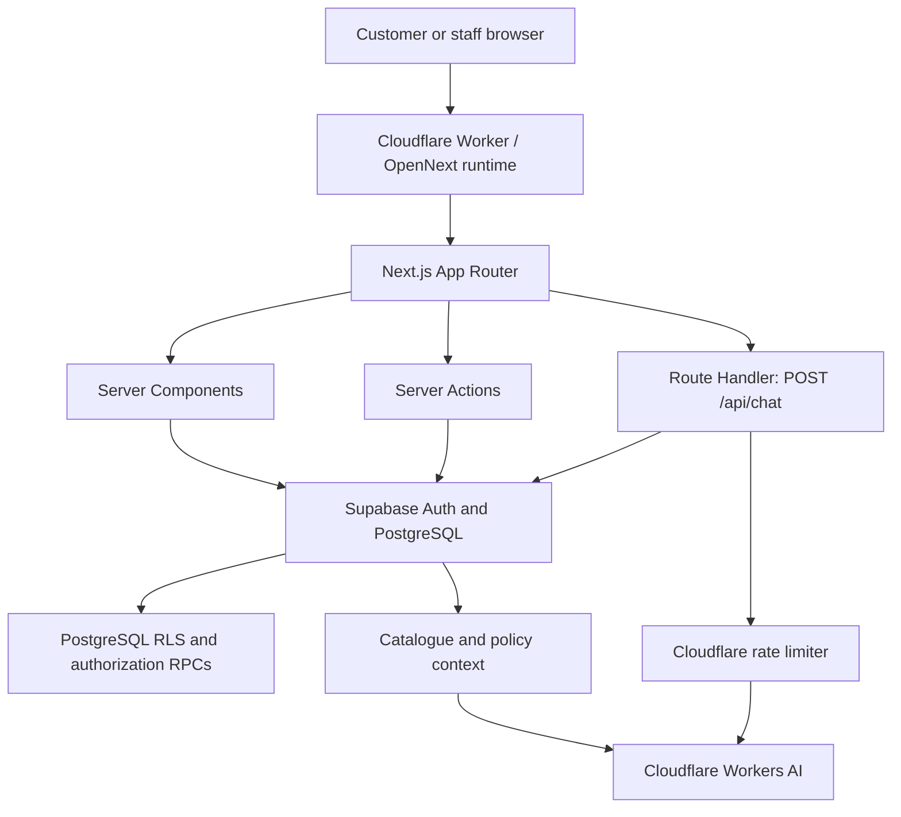
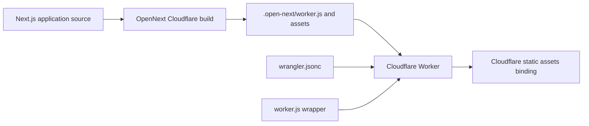

# Solenne


[🇬🇧 English](README.md) | [🇻🇳 Tiếng Việt](README.vi.md)

### A full-stack commerce platform for an artisan candle brand

Solenne is a full-stack e-commerce and store-operations platform built around an artisan candle brand. It combines a bilingual customer storefront, account and checkout flows, a role-aware administration dashboard, and an AI scent concierge.

The project demonstrates end-to-end product engineering: customer-facing experiences, server-side business workflows, relational data integrity, authorization, operational tooling, performance work, and edge deployment.

> **Project status:** The storefront, customer accounts, checkout/order creation, order management, inventory, product and customer management, audit history, and AI assistant are implemented. Online payment processing is not yet integrated; new orders remain in a pending-payment state. See [Current scope and limitations](#current-scope-and-limitations).

## Engineering capabilities

- **Full-stack application development:** Next.js App Router, React, TypeScript, Server Components, Server Actions, and PostgreSQL.
- **Application and database security:** Supabase Auth, permission-based RBAC, PostgreSQL RLS, authorization RPCs, and audit logging.
- **Business workflow engineering:** validated checkout, order lifecycle transitions, cancellation with inventory restoration, and controlled stock adjustments.
- **AI integration:** streamed, bilingual product guidance grounded in the live catalogue and store-policy context, with bounded request usage.

## Table of contents

- [Platform capabilities](#platform-capabilities)
- [Technology stack](#technology-stack)
- [Visual preview](#visual-preview)
- [Runtime architecture](#runtime-architecture)
- [Application structure](#application-structure)
- [Engineering highlights](#engineering-highlights)
- [Security and data handling](#security-and-data-handling)
- [Local development](#local-development)
- [Verification](#verification)
- [Deployment architecture](#deployment-architecture)
- [Current scope and limitations](#current-scope-and-limitations)
- [Author](#author)

---

## Platform capabilities

| Area | Capabilities |
| --- | --- |
| **Storefront** | Product catalogue, product details, scent collections, product discovery, editorial pages, and responsive navigation |
| **Customer account** | Authentication, profile and address management, order history, and account-specific views |
| **Checkout and orders** | Validated checkout, server-side price calculation, order creation, cancellation, and fulfillment status transitions |
| **Administration** | Role-aware dashboard for orders, products, variants, inventory, customers, and audit history |
| **AI concierge** | Streaming, bilingual scent and product guidance grounded in the live product catalogue and store policies |
| **Localization** | Vietnamese and English interfaces, locale-aware content, and currency presentation in USD/VND |
| **Experience and performance** | Responsive UI, optimized product imagery, scoped animation, and request-level server data deduplication |

## Technology stack

**Frontend**
- Next.js 16 App Router and React 19
- TypeScript 5 and Tailwind CSS v4
- Framer Motion and GSAP
- Lenis for smooth scrolling
- Zustand for client-side state
- next-intl for Vietnamese/English localization

**Backend and data**
- Supabase PostgreSQL
- Supabase Auth and `@supabase/ssr`
- PostgreSQL Row Level Security (RLS)
- Role-Based Access Control (RBAC)
- Server Actions and Route Handlers
- Zod for application input validation

**AI and infrastructure**
- Cloudflare Workers AI
- Vercel AI SDK streaming APIs
- OpenNext for Cloudflare
- Cloudflare Workers and Wrangler

---

## Visual preview

Screenshots from the Solenne storefront and administration interface. The live demo is available at [solenne.dangvohoangvan.workers.dev](https://solenne.dangvohoangvan.workers.dev/).

### Storefront homepage

<p align="center">
  
</p>

### Product detail — Midnight Garden

<p align="center">
  
</p>

### Admin dashboard

<p align="center">
  
</p>

### AI scent concierge

<p align="center">
  
</p>

<sub>The administration screenshot is from an authenticated administrator session. The account identifier in the lower-left sidebar has been blurred before publishing.</sub>

---

## Runtime architecture

The Next.js App Router is the application boundary. Server Components read data for pages, Server Actions handle validated business mutations, and the `POST /api/chat` Route Handler streams AI responses.



### Request boundaries

- **Page reads:** Server Components use server-side Supabase access and database policies to retrieve the data required by each page.
- **Business mutations:** Server Actions validate input and enforce application authorization before invoking the relevant data operation or database RPC.
- **AI conversations:** The chat Route Handler applies request limits, loads catalogue context, applies the Cloudflare rate limiter, and streams a response from Workers AI.
- **Database enforcement:** RLS and database-side authorization checks provide a separate enforcement layer from the application UI.

## Application structure

```text
app/
├── (marketing)/       # Storefront, catalogue, collections, journal, account, checkout
├── (auth)/            # Login, registration, password recovery
├── admin/             # Permission-protected management dashboard
├── actions/           # Server Actions for business operations
├── api/chat/          # Streaming AI concierge endpoint
└── auth/callback/     # Authentication callback and post-login routing

components/
├── admin/             # Admin shell, data tables, controls, KPI and chart components
├── assistant/         # Customer-facing AI chat widget
├── product/           # Catalogue and product-detail UI
├── checkout/          # Checkout experience
└── layout/            # Navigation, footer, localization and bottom dock

lib/
├── assistant/         # Catalogue context and model-stream handling
├── supabase/          # Browser, server, middleware and session clients
├── authz.ts           # Server-side authorization primitives
├── admin-*.ts         # Admin data-access modules
└── validations/       # Zod input schemas

supabase/migrations/   # Versioned PostgreSQL schema, RBAC, RLS and RPC changes
scripts/               # Targeted verification and operational scripts
```

---

## Engineering highlights

### 1. Permission-based administration with database enforcement

The admin dashboard is not protected only by hidden navigation links or client-side role checks.

- Four roles are represented in the database: **customer, staff, manager, and admin**.
- Roles map to explicit permission keys such as `order.read`, `inventory.update`, and `staff.manage`.
- Server-side guards in `lib/authz.ts` resolve the authenticated actor and enforce active-account status and required permissions.
- PostgreSQL RLS policies independently scope access to private data.
- Sensitive business operations use database functions with authorization and validation checks where appropriate.
- Audit events record important administrative and operational actions.

The database is the source of truth for role and permission assignments. Client-provided role names, user IDs, and UI visibility are not treated as authorization evidence.

### 2. Transaction-aware commerce operations

Order and inventory workflows are designed around data integrity rather than treating each button click as an isolated update.

Implemented workflows include:

- Server-side checkout validation and price recomputation from product variants.
- Order cancellation with inventory restoration.
- Controlled order-fulfillment transitions and tracking-code validation.
- Inventory adjustments with reason validation and stock-boundary checks.
- Customer account-status management, including controlled reinstatement.
- Audit logging for important administrative operations.

Critical state transitions use database RPCs so related authorization, validation, and database changes can be enforced at the database boundary. Application-level checks provide an additional layer before those operations are invoked.

### 3. A catalogue-grounded AI shopping assistant

The **Solenne Scent Concierge** helps customers explore fragrance profiles, compare suitable candles, understand product details, and find store-policy information.

**Request flow**

1. The chat widget sends the conversation to `POST /api/chat`.
2. The Route Handler checks that the request body is valid JSON and that `messages` is a non-empty array.
3. It retains the latest 12 messages and enforces a combined text-input budget of 4,000 characters.
4. The server loads the current product catalogue and assembles product details, variants, prices, stock information, scent notes, and policy context into the model instructions.
5. Cloudflare Workers AI generates a streamed response through the Vercel AI SDK.
6. A stream transform removes duplicate text deltas observed from the configured model/provider combination.

**Runtime limits**

| Setting | Current implementation |
| --- | --- |
| Model | `@cf/meta/llama-3.3-70b-instruct-fp8-fast` |
| Conversation window | Latest 12 messages |
| Text input budget | 4,000 characters |
| Output limit | 400 tokens |
| Rate limit | 10 requests per 60 seconds per client IP key |

The IP-based rate limit is a coarse abuse-control measure: users behind the same public IP may share the limit, and Cloudflare applies the limit per location.

**Scope boundary:** this is a catalogue-grounded conversational assistant, not a retrieval-augmented generation (RAG) system. The current endpoint performs basic request-shape checks and size limits; it does not apply a Zod schema to every incoming message. The assistant does not access customer accounts, look up or modify orders, accept payments, or execute purchases. Conversation history is held in client memory and is not persisted.

### 4. Request-level authentication and data-fetch optimization

Repeated authentication and actor lookups can add avoidable latency to server-rendered pages.

The server session layer uses React `cache()` to deduplicate the Supabase server client and verified-user lookup within a render request. Actor-context resolution is also memoized for the request, allowing the admin layout and protected data modules to share the same authorization context without introducing cross-request user caching.

This is request-scoped deduplication, not a long-lived cache of authentication or permission decisions. Protected routes and actions continue to enforce their own authorization requirements.

### 5. Frontend performance and motion lifecycle

The storefront uses visual motion as part of the brand experience while keeping animation work bounded.

- Explicit cleanup for GSAP animation and ticker lifecycles.
- Shared Lenis access rather than creating unnecessary smooth-scroll instances.
- Visibility-based activation for expensive visual sections.
- Deferred or scoped animation for below-the-fold content.
- Product-image generation in AVIF/WebP formats for responsive delivery.
- A coordinated floating dock so the chat panel and back-to-top control do not overlap.

The admin dashboard uses reusable page headers, KPI cards, tables, filters, pagination, status controls, and CSS-based chart visualizations to maintain a consistent management interface.

### 6. Performance measurement discipline

Performance work has focused on reducing avoidable work in both the storefront and the management experience:

- Request-scoped session/client reuse and actor-context deduplication.
- Responsive AVIF/WebP product-image variants.
- Explicit animation cleanup and visibility-aware activation.
- Shared scrolling and UI primitives to avoid duplicated lifecycle work.

**Benchmark status:** the repository does not currently include a configured Lighthouse, Playwright, or Web Vitals reporting pipeline. No Lighthouse score or before/after percentage is claimed here.

A reproducible benchmark should record the tested commit and environment, then report:

- **Storefront:** LCP, INP, CLS, and TTFB from repeated mobile and desktop production runs; report the median rather than the best run.
- **Authenticated admin:** route response time and TTFB, reporting p50 and p95 across repeated requests; separate cold and warm runs.
- **Conditions:** route, device/network profile, browser, cache state, sample count, and measurement date.

---

## Security and data handling

| Layer | Responsibility |
| --- | --- |
| **Supabase Auth** | Authenticates users and verifies their sessions on the server |
| **Application authorization** | Resolves the current actor and checks account status and explicit permissions |
| **PostgreSQL RLS** | Restricts access to private rows independently of the UI |
| **Database RPCs** | Enforce authorization and business invariants for critical operations |
| **Server-only credentials** | Used only in server-side code paths that require trusted database access; never exposed to browser code |
| **Audit trail** | Records relevant administrative actions in an append-oriented audit log |

The public product catalogue is intentionally readable by storefront visitors, while catalogue writes are restricted to trusted server-side operations. Private customer and order data follows separate authorization and RLS rules.

Database changes are versioned under `supabase/migrations/`. Read [supabase/README.md](supabase/README.md) before applying them. It documents the migration order and the operator-only administrator bootstrap step.

---

## Local development

### Prerequisites

- **Node.js 20.9 or newer** (the minimum supported by Next.js 16; see the [Next.js installation requirements](https://nextjs.org/docs/app/getting-started/installation)).
- **pnpm 9 or newer**, compatible with the committed `pnpm-lock.yaml` lockfile format (`9.0`).
- A Supabase project with the required schema and seed data.

The repository does not pin an exact pnpm release in `package.json`; use a pnpm version that can read the committed lockfile without rewriting it.

### 1. Install dependencies

```bash
pnpm install --frozen-lockfile
```

### 2. Configure environment variables

Create a local `.env.local` file in the project root:

```dotenv
NEXT_PUBLIC_SUPABASE_URL=https://<your-project-ref>.supabase.co
NEXT_PUBLIC_SUPABASE_PUBLISHABLE_KEY=sb_publishable_<your-publishable-key>
SUPABASE_SECRET_KEY=sb_secret_<your-secret-key>
```

Use your own Supabase project values. Keep secret keys in server-side environment configuration only; never commit `.env.local` or expose a secret key through a `NEXT_PUBLIC_` variable.

### 3. Prepare the database

Review [supabase/README.md](supabase/README.md) before applying migrations. The SQL files cover the schema, RBAC, RLS, business RPCs, and contact/newsletter persistence.

The schema/security chain is applied in the documented order. `0004_bootstrap_admin.sql` is an operator-only, one-time action outside the routine migration chain; do not apply it blindly.

### 4. Run the application

```bash
pnpm dev
```

Open [http://localhost:3000](http://localhost:3000).

The local Next.js development server does not by itself provide Cloudflare runtime bindings. Cloudflare-specific functionality, including the Workers AI binding and rate limiter, must be validated through the OpenNext Cloudflare preview workflow.

---

## Verification

The repository includes targeted Node.js verification scripts for business invariants, routing behavior, and source wiring. They are not a configured Jest/Vitest unit, integration, or end-to-end test suite.

**Type checking and linting**

```bash
pnpm exec tsc --noEmit
pnpm lint
```

**Targeted verification**

```bash
node scripts/verify-rbac.mjs
node scripts/verify-cancel-order.mjs
node scripts/verify-fulfillment-transitions.mjs
node scripts/verify-inventory-adjustment.mjs
node scripts/verify-customer-status.mjs
node scripts/verify-product-management.mjs
node scripts/verify-post-login-routing.mjs
node scripts/verify-callback-redirect.mjs
node scripts/verify-contact-newsletter.mjs
```

Some database verification scripts require the environment variables and database state described in the Supabase guide. Check each script's header before running it. In particular, `verify-rbac.mjs` is read-only by default; its `--full` mode creates disposable test accounts and an order before cleaning them up. Run data-writing checks only against an environment intended for testing.

---

## Deployment architecture

The application is built for **OpenNext on Cloudflare Workers**. The deployment path is separate from the runtime request flow shown above.



Repository configuration:

- `open-next.config.ts` defines the OpenNext Cloudflare adapter configuration.
- `wrangler.jsonc` declares the Worker, static assets, Workers AI binding, rate limiter, and service binding.
- `worker.js` wraps the generated OpenNext Worker and applies a response-header compatibility adjustment.
- `package.json` provides build, preview, deploy, and upload scripts.

Useful commands:

```bash
pnpm build:worker
pnpm preview
```

A deployment command is also available through `pnpm deploy`. Production deployment requires the appropriate Cloudflare account configuration and authentication. Repository configuration alone does not prove that a particular commit is deployed.

**Live demo:** [Open Solenne](https://solenne.dangvohoangvan.workers.dev/) — hosted on Cloudflare Workers. The demo URL is provided by the project owner; reviewers should verify current availability and runtime behavior when evaluating the project.

---

## Current scope and limitations

Solenne is an actively developed portfolio project. The following boundaries are documented intentionally:

- **Payments:** Stripe dependencies are present, but payment-session creation, payment confirmation, webhook handling, and end-to-end payment reconciliation are not yet implemented. Orders currently remain in a pending-payment state.
- **AI assistant:** provides product and policy guidance only; it cannot access personal account data or perform transactional actions.
- **Content:** some editorial and marketing content is static.
- **Automated testing:** targeted verification scripts are available, but a full unit, integration, or end-to-end test suite is not configured.

These limitations are stated explicitly so the implemented scope can be evaluated accurately.

---

## Author

**Đặng Võ Hoàng Văn**  
Data Science graduate, HUFLIT · Independent project author

I built Solenne as an end-to-end engineering project, working across the customer storefront, server-side business workflows, PostgreSQL schema and authorization layer, administration tools, and AI assistant integration.

- **GitHub:** [@hoangvanpierre](https://github.com/hoangvanpierre)
- **Contact:** [dangvohoangvan@gmail.com](mailto:dangvohoangvan@gmail.com)

**Repository:** [github.com/hoangvanpierre/Solenne](https://github.com/hoangvanpierre/Solenne)
