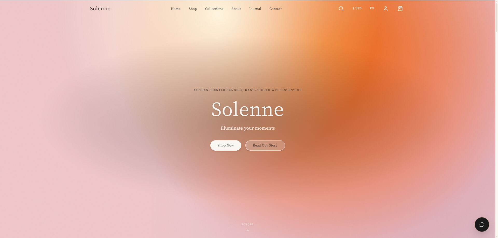
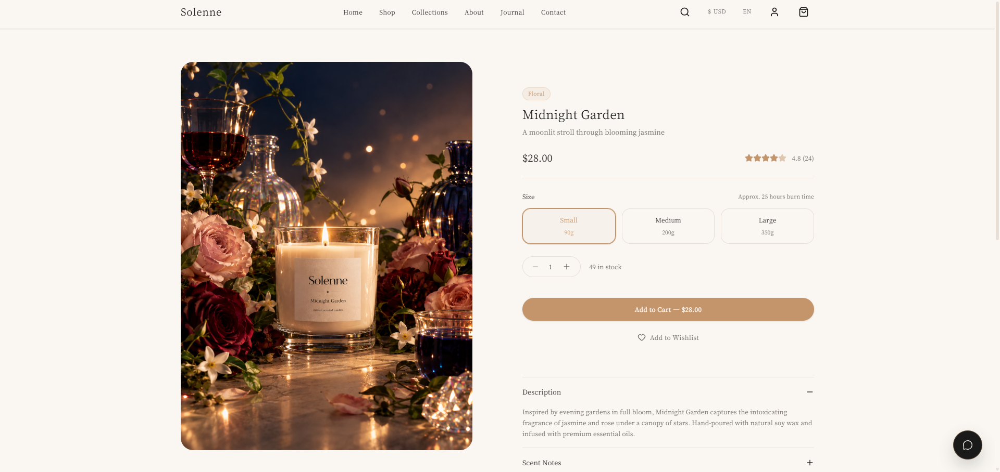
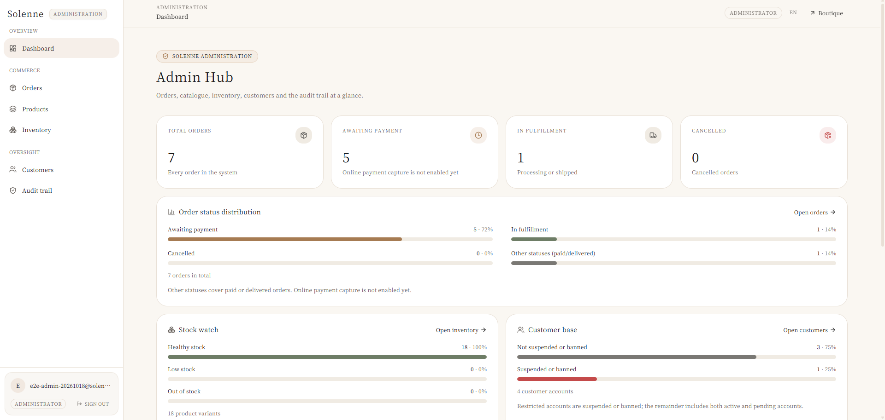
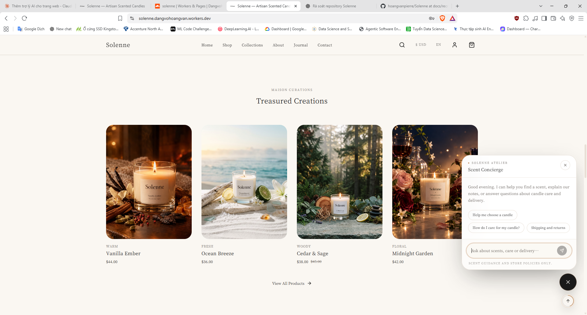
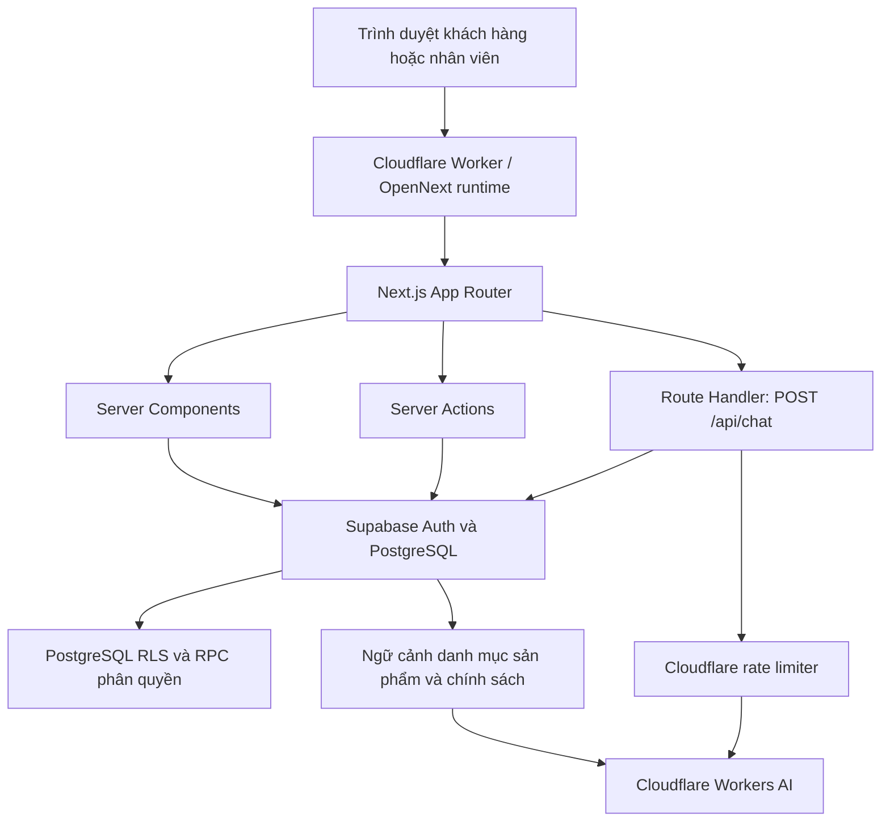
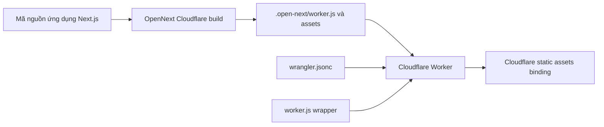

# Solenne


[🇬🇧 English](README.md) | **🇻🇳 Tiếng Việt**

### Nền tảng thương mại điện tử full-stack dành cho thương hiệu nến thủ công

Solenne là nền tảng thương mại điện tử và vận hành cửa hàng full-stack được xây dựng xoay quanh một thương hiệu nến thủ công. Dự án kết hợp website bán hàng song ngữ, luồng tài khoản và thanh toán đơn hàng, trang quản trị phân quyền theo vai trò và trợ lý AI tư vấn mùi hương.

Dự án thể hiện quy trình phát triển sản phẩm phần mềm từ đầu đến cuối: trải nghiệm khách hàng, nghiệp vụ xử lý phía máy chủ, tính toàn vẹn dữ liệu quan hệ, phân quyền, công cụ vận hành, tối ưu hiệu năng và triển khai trên hạ tầng edge.

> **Trạng thái dự án:** Đã triển khai website bán hàng, tài khoản khách hàng, luồng checkout và tạo đơn hàng, quản lý đơn hàng, tồn kho, sản phẩm, khách hàng, lịch sử kiểm toán và trợ lý AI. Xử lý thanh toán trực tuyến chưa được tích hợp; đơn hàng mới hiện ở trạng thái chờ thanh toán. Xem [Phạm vi hiện tại và các giới hạn](#phạm-vi-hiện-tại-và-các-giới-hạn).

## Năng lực kỹ thuật thể hiện

- **Phát triển ứng dụng full-stack:** Next.js App Router, React, TypeScript, Server Components, Server Actions và PostgreSQL.
- **Bảo mật ứng dụng và cơ sở dữ liệu:** Supabase Auth, RBAC dựa trên quyền, PostgreSQL RLS, RPC phân quyền và ghi nhật ký kiểm toán.
- **Xây dựng quy trình nghiệp vụ:** checkout có xác thực dữ liệu, chuyển đổi trạng thái đơn hàng, hủy đơn kèm hoàn trả tồn kho và điều chỉnh số lượng hàng có kiểm soát.
- **Tích hợp AI:** tư vấn sản phẩm song ngữ dạng streaming, dựa trên danh mục sản phẩm và ngữ cảnh chính sách cửa hàng đang được cập nhật, kèm giới hạn sử dụng request.

## Mục lục

- [Các chức năng nền tảng](#các-chức-năng-nền-tảng)
- [Công nghệ sử dụng](#công-nghệ-sử-dụng)
- [Hình ảnh giao diện](#hình-ảnh-giao-diện)
- [Kiến trúc runtime](#kiến-trúc-runtime)
- [Cấu trúc ứng dụng](#cấu-trúc-ứng-dụng)
- [Các điểm nổi bật về kỹ thuật](#các-điểm-nổi-bật-về-kỹ-thuật)
- [Bảo mật và xử lý dữ liệu](#bảo-mật-và-xử-lý-dữ-liệu)
- [Chạy dự án trên máy local](#chạy-dự-án-trên-máy-local)
- [Kiểm tra và xác minh](#kiểm-tra-và-xác-minh)
- [Kiến trúc triển khai](#kiến-trúc-triển-khai)
- [Phạm vi hiện tại và các giới hạn](#phạm-vi-hiện-tại-và-các-giới-hạn)
- [Tác giả](#tác-giả)

---

## Các chức năng nền tảng

| Phân hệ | Chức năng |
| --- | --- |
| **Website bán hàng** | Danh mục sản phẩm, trang chi tiết, bộ sưu tập mùi hương, khám phá sản phẩm, trang biên tập nội dung và điều hướng responsive |
| **Tài khoản khách hàng** | Xác thực, quản lý hồ sơ và địa chỉ, lịch sử đơn hàng và các trang theo tài khoản |
| **Checkout và đơn hàng** | Checkout có xác thực dữ liệu, tính lại giá phía máy chủ, tạo đơn, hủy đơn và chuyển trạng thái xử lý |
| **Quản trị** | Dashboard phân quyền theo vai trò để quản lý đơn hàng, sản phẩm, biến thể, tồn kho, khách hàng và lịch sử kiểm toán |
| **Trợ lý AI** | Tư vấn mùi hương và sản phẩm song ngữ dạng streaming, dựa trên danh mục sản phẩm và chính sách cửa hàng |
| **Đa ngôn ngữ** | Giao diện tiếng Việt và tiếng Anh, nội dung theo ngôn ngữ và hiển thị tiền tệ USD/VND |
| **Trải nghiệm và hiệu năng** | Giao diện responsive, tối ưu hình ảnh sản phẩm, giới hạn phạm vi animation và loại bỏ truy vấn dữ liệu trùng lặp trong cùng request |

## Công nghệ sử dụng

**Frontend**
- Next.js 16 App Router và React 19
- TypeScript 5 và Tailwind CSS v4
- Framer Motion và GSAP
- Lenis cho hiệu ứng cuộn mượt
- Zustand cho trạng thái phía client
- next-intl cho đa ngôn ngữ Việt/Anh

**Backend và dữ liệu**
- Supabase PostgreSQL
- Supabase Auth và `@supabase/ssr`
- PostgreSQL Row Level Security (RLS)
- Role-Based Access Control (RBAC)
- Server Actions và Route Handlers
- Zod để xác thực dữ liệu đầu vào ở tầng ứng dụng

**AI và hạ tầng**
- Cloudflare Workers AI
- API streaming của Vercel AI SDK
- OpenNext cho Cloudflare
- Cloudflare Workers và Wrangler

---

## Hình ảnh giao diện

Một số ảnh chụp giao diện website bán hàng và trang quản trị Solenne. Có thể truy cập bản demo tại [solenne.dangvohoangvan.workers.dev](https://solenne.dangvohoangvan.workers.dev/).

### Trang chủ

<p align="center">
  
</p>

### Chi tiết sản phẩm — Midnight Garden

<p align="center">
  
</p>

### Trang quản trị

<p align="center">
  
</p>

### Trợ lý AI tư vấn mùi hương

<p align="center">
  
</p>

<sub>Ảnh trang quản trị được chụp từ phiên đăng nhập của quản trị viên. Thông tin định danh tài khoản ở góc dưới bên trái đã được làm mờ trước khi công bố.</sub>

---

## Kiến trúc runtime

Next.js App Router là ranh giới xử lý chính của ứng dụng. Server Components đọc dữ liệu để dựng trang, Server Actions xử lý các thay đổi nghiệp vụ đã được xác thực, còn Route Handler `POST /api/chat` đảm nhiệm việc stream phản hồi từ AI.



### Ranh giới xử lý request

- **Đọc dữ liệu trang:** Server Components sử dụng Supabase phía máy chủ và các chính sách cơ sở dữ liệu để truy xuất dữ liệu cần thiết cho từng trang.
- **Thay đổi nghiệp vụ:** Server Actions xác thực dữ liệu đầu vào và kiểm tra quyền ở tầng ứng dụng trước khi gọi thao tác dữ liệu hoặc database RPC tương ứng.
- **Hội thoại AI:** Route Handler kiểm tra giới hạn request, tải ngữ cảnh danh mục sản phẩm, áp dụng Cloudflare rate limiter và stream phản hồi từ Workers AI.
- **Thực thi ở cơ sở dữ liệu:** RLS và các kiểm tra phân quyền phía database tạo thành một lớp bảo vệ độc lập với giao diện ứng dụng.

## Cấu trúc ứng dụng

```text
app/
├── (marketing)/       # Website bán hàng, danh mục, bộ sưu tập, journal, tài khoản, checkout
├── (auth)/            # Đăng nhập, đăng ký, khôi phục mật khẩu
├── admin/             # Dashboard quản trị được bảo vệ theo quyền
├── actions/           # Server Actions xử lý nghiệp vụ
├── api/chat/          # Endpoint streaming cho trợ lý AI
└── auth/callback/     # Callback xác thực và điều hướng sau đăng nhập

components/
├── admin/             # Admin shell, bảng dữ liệu, điều khiển, KPI và biểu đồ
├── assistant/         # Widget trò chuyện AI dành cho khách hàng
├── product/           # Giao diện danh mục và chi tiết sản phẩm
├── checkout/          # Trải nghiệm checkout
└── layout/            # Điều hướng, footer, đa ngôn ngữ và bottom dock

lib/
├── assistant/         # Ngữ cảnh danh mục và xử lý model stream
├── supabase/          # Client browser, server, middleware và session
├── authz.ts           # Các primitive phân quyền phía máy chủ
├── admin-*.ts          # Module truy cập dữ liệu quản trị
└── validations/       # Schema đầu vào Zod

supabase/migrations/   # Schema PostgreSQL, RBAC, RLS và RPC được version hóa
scripts/               # Script xác minh và vận hành theo từng phạm vi
```

---

## Các điểm nổi bật về kỹ thuật

### 1. Quản trị theo quyền kết hợp thực thi bảo mật ở database

Dashboard quản trị không chỉ được bảo vệ bằng cách ẩn liên kết điều hướng hoặc kiểm tra vai trò ở phía client.

- Cơ sở dữ liệu định nghĩa bốn vai trò: **customer, staff, manager và admin**.
- Mỗi vai trò được ánh xạ tới các khóa quyền cụ thể như `order.read`, `inventory.update` và `staff.manage`.
- Các guard phía máy chủ trong `lib/authz.ts` xác định actor đã xác thực, kiểm tra trạng thái tài khoản và các quyền bắt buộc.
- Chính sách PostgreSQL RLS độc lập giới hạn quyền truy cập vào dữ liệu riêng tư.
- Các nghiệp vụ nhạy cảm sử dụng database function có kiểm tra phân quyền và xác thực dữ liệu khi phù hợp.
- Audit event ghi nhận các thao tác quản trị và vận hành quan trọng.

Database là nguồn dữ liệu chuẩn cho việc gán vai trò và quyền. Tên vai trò, user ID do client gửi lên hoặc trạng thái hiển thị của UI không được xem là bằng chứng phân quyền.

### 2. Nghiệp vụ thương mại điện tử chú trọng tính toàn vẹn giao dịch

Các luồng đơn hàng và tồn kho được thiết kế xoay quanh tính toàn vẹn dữ liệu, thay vì xem mỗi lần nhấn nút là một cập nhật độc lập.

Các luồng đã triển khai:

- Xác thực checkout phía máy chủ và tính lại giá dựa trên biến thể sản phẩm.
- Hủy đơn hàng kèm hoàn trả tồn kho.
- Chuyển trạng thái xử lý đơn hàng có kiểm soát và xác thực mã vận đơn.
- Điều chỉnh tồn kho với lý do bắt buộc và kiểm tra giới hạn số lượng.
- Quản lý trạng thái tài khoản khách hàng, bao gồm quy trình kích hoạt lại có kiểm soát.
- Ghi audit log cho các thao tác quản trị quan trọng.

Các chuyển đổi trạng thái quan trọng sử dụng database RPC để có thể thực thi phân quyền, xác thực và thay đổi dữ liệu liên quan ngay tại ranh giới cơ sở dữ liệu. Kiểm tra ở tầng ứng dụng đóng vai trò như một lớp bảo vệ bổ sung trước khi gọi các thao tác đó.

### 3. Trợ lý AI tư vấn mua sắm dựa trên dữ liệu danh mục sản phẩm

**Solenne Scent Concierge** hỗ trợ khách hàng khám phá nhóm hương, so sánh các loại nến phù hợp, tìm hiểu thông tin sản phẩm và tra cứu chính sách cửa hàng.

**Luồng xử lý request**

1. Widget chat gửi hội thoại tới `POST /api/chat`.
2. Route Handler kiểm tra request body có phải JSON hợp lệ và `messages` có phải một mảng không rỗng hay không.
3. Hệ thống giữ lại 12 tin nhắn gần nhất và giới hạn tổng độ dài văn bản đầu vào ở mức 4.000 ký tự.
4. Máy chủ tải danh mục sản phẩm hiện tại và tổng hợp thông tin sản phẩm, biến thể, giá, tồn kho, tầng hương và ngữ cảnh chính sách vào phần chỉ dẫn cho model.
5. Cloudflare Workers AI tạo phản hồi dạng streaming thông qua Vercel AI SDK.
6. Một stream transform loại bỏ các text delta trùng lặp được quan sát ở cấu hình model/provider hiện tại.

**Giới hạn runtime**

| Thiết lập | Cấu hình hiện tại |
| --- | --- |
| Model | `@cf/meta/llama-3.3-70b-instruct-fp8-fast` |
| Cửa sổ hội thoại | 12 tin nhắn gần nhất |
| Giới hạn văn bản đầu vào | 4.000 ký tự |
| Giới hạn đầu ra | 400 tokens |
| Rate limit | 10 request trong 60 giây trên mỗi khóa client IP |

Rate limit dựa trên IP là biện pháp kiểm soát lạm dụng ở mức cơ bản: nhiều người dùng chung một địa chỉ IP công khai có thể dùng chung giới hạn, và Cloudflare áp dụng giới hạn theo từng location.

**Ranh giới phạm vi:** đây là trợ lý hội thoại dựa trên danh mục sản phẩm, không phải hệ thống Retrieval-Augmented Generation (RAG). Endpoint hiện tại thực hiện kiểm tra cấu trúc request cơ bản và giới hạn kích thước; chưa áp dụng Zod schema cho từng message đầu vào. Trợ lý không truy cập tài khoản khách hàng, tra cứu hoặc chỉnh sửa đơn hàng, nhận thanh toán hay thực hiện mua hàng. Lịch sử hội thoại chỉ được giữ trong bộ nhớ phía client và không được lưu trữ lâu dài.

### 4. Tối ưu xác thực và truy xuất dữ liệu trong phạm vi từng request

Việc lặp lại các bước xác thực và truy vấn actor có thể tạo ra độ trễ không cần thiết cho các trang server-rendered.

Session layer phía máy chủ sử dụng React `cache()` để loại bỏ các lần khởi tạo Supabase server client và truy vấn verified-user trùng lặp trong cùng một render request. Việc phân giải actor context cũng được memoize theo request, cho phép admin layout và các module dữ liệu được bảo vệ dùng chung ngữ cảnh phân quyền mà không tạo cache user xuyên request.

Đây là cơ chế loại bỏ truy vấn trùng lặp trong phạm vi request, không phải cache xác thực hoặc quyết định phân quyền dài hạn. Các protected route và action vẫn tiếp tục thực thi các yêu cầu phân quyền riêng.

### 5. Hiệu năng frontend và vòng đời motion

Storefront sử dụng chuyển động thị giác như một phần của trải nghiệm thương hiệu, đồng thời giới hạn khối lượng công việc animation.

- Dọn dẹp rõ ràng vòng đời animation và ticker của GSAP.
- Dùng chung Lenis thay vì tạo các instance smooth-scroll không cần thiết.
- Chỉ kích hoạt các khu vực hiển thị tốn tài nguyên khi chúng đi vào vùng quan sát.
- Trì hoãn hoặc giới hạn animation cho nội dung nằm bên dưới màn hình đầu tiên.
- Tạo ảnh sản phẩm ở định dạng AVIF/WebP để phân phối responsive.
- Điều phối floating dock để khung chat và nút quay lại đầu trang không chồng lấn.

Dashboard quản trị sử dụng các page header, KPI card, bảng dữ liệu, bộ lọc, phân trang, điều khiển trạng thái và biểu đồ CSS có thể tái sử dụng nhằm duy trì giao diện quản lý nhất quán.

### 6. Nguyên tắc đo lường hiệu năng

Công việc tối ưu hiệu năng tập trung vào việc giảm các tác vụ dư thừa ở cả storefront và khu vực quản trị:

- Tái sử dụng session/client và loại bỏ truy vấn actor context trùng lặp trong phạm vi request.
- Các biến thể hình ảnh sản phẩm AVIF/WebP theo kích thước màn hình.
- Dọn dẹp animation rõ ràng và chỉ kích hoạt hiệu ứng khi cần thiết.
- Dùng chung các primitive về scrolling và UI để tránh lặp lại công việc quản lý vòng đời.

**Tình trạng benchmark:** repository hiện chưa có pipeline Lighthouse, Playwright hoặc Web Vitals được cấu hình. Vì vậy, tài liệu này không tuyên bố điểm Lighthouse hay phần trăm cải thiện trước/sau.

Một benchmark có thể tái lập cần ghi nhận commit và môi trường được kiểm thử, sau đó báo cáo:

- **Storefront:** LCP, INP, CLS và TTFB qua nhiều lần chạy production trên mobile và desktop; sử dụng giá trị trung vị thay vì lần chạy tốt nhất.
- **Admin đã đăng nhập:** thời gian phản hồi route và TTFB, báo cáo p50 và p95 qua nhiều request; tách riêng lần chạy cold và warm.
- **Điều kiện đo:** route, cấu hình thiết bị/mạng, trình duyệt, trạng thái cache, số mẫu và ngày đo.

---

## Bảo mật và xử lý dữ liệu

| Lớp | Trách nhiệm |
| --- | --- |
| **Supabase Auth** | Xác thực người dùng và xác minh session ở phía máy chủ |
| **Phân quyền ứng dụng** | Xác định actor hiện tại, kiểm tra trạng thái tài khoản và các quyền cụ thể |
| **PostgreSQL RLS** | Giới hạn quyền truy cập các bản ghi riêng tư độc lập với UI |
| **Database RPCs** | Thực thi phân quyền và các bất biến nghiệp vụ cho thao tác quan trọng |
| **Thông tin xác thực chỉ dùng phía server** | Chỉ sử dụng trong các luồng xử lý phía máy chủ cần quyền truy cập database đáng tin cậy; không đưa ra mã chạy trên trình duyệt |
| **Audit trail** | Ghi lại các thao tác quản trị liên quan trong audit log theo hướng bổ sung bản ghi |

Danh mục sản phẩm công khai được phép đọc bởi khách truy cập storefront, trong khi thao tác ghi danh mục bị giới hạn ở các luồng phía máy chủ đáng tin cậy. Dữ liệu riêng tư của khách hàng và đơn hàng tuân theo các quy tắc phân quyền và RLS riêng.

Các thay đổi database được version hóa trong `supabase/migrations/`. Hãy đọc [supabase/README.md](supabase/README.md) trước khi áp dụng migration. Tài liệu này mô tả thứ tự migration và bước bootstrap tài khoản quản trị chỉ dành cho người vận hành.

---

## Chạy dự án trên máy local

### Yêu cầu môi trường

- **Node.js 22.18 trở lên** (bắt buộc cho bộ unit test, vì test chạy trực tiếp file `.ts` bằng cơ chế type stripping có sẵn của Node). **Node.js 24.x là phiên bản được khuyến nghị và được CI kiểm thử**; repository đang phát triển trên 24.x. Bản thân Next.js 16 chỉ yêu cầu 20.9, nên 22.18+ là mức tối thiểu riêng của repository này. Xem [yêu cầu cài đặt Next.js](https://nextjs.org/docs/app/getting-started/installation).
- **pnpm 9 trở lên**, tương thích với định dạng lockfile `9.0` trong `pnpm-lock.yaml`.
- Một Supabase project đã có schema và seed data cần thiết.

Repository chưa cố định chính xác phiên bản pnpm trong `package.json`; hãy sử dụng phiên bản pnpm có thể đọc lockfile hiện tại mà không tự ý ghi lại lockfile.

### 1. Cài đặt dependencies

```bash
pnpm install --frozen-lockfile
```

### 2. Cấu hình biến môi trường

Tạo file `.env.local` tại thư mục gốc của dự án:

```dotenv
NEXT_PUBLIC_SUPABASE_URL=https://<your-project-ref>.supabase.co
NEXT_PUBLIC_SUPABASE_PUBLISHABLE_KEY=sb_publishable_<your-publishable-key>
SUPABASE_SECRET_KEY=sb_secret_<your-secret-key>
```

Sử dụng thông tin của Supabase project do bạn quản lý. Secret key chỉ được đặt trong cấu hình môi trường phía máy chủ; tuyệt đối không commit `.env.local` hoặc đưa secret key vào biến có tiền tố `NEXT_PUBLIC_`.

### 3. Chuẩn bị cơ sở dữ liệu

Đọc [supabase/README.md](supabase/README.md) trước khi áp dụng migration. Các file SQL bao gồm schema, RBAC, RLS, business RPC và phần lưu trữ contact/newsletter.

Chuỗi schema/security phải được áp dụng theo đúng thứ tự đã tài liệu hóa. `0004_bootstrap_admin.sql` là thao tác một lần chỉ dành cho người vận hành, nằm ngoài chuỗi migration thông thường; không chạy file này một cách tùy tiện.

### 4. Khởi chạy ứng dụng

```bash
pnpm dev
```

Mở [http://localhost:3000](http://localhost:3000).

Next.js development server chạy local không tự cung cấp các binding của Cloudflare runtime. Những chức năng phụ thuộc Cloudflare, bao gồm Workers AI binding và rate limiter, cần được xác minh thông qua quy trình preview OpenNext dành cho Cloudflare.

---

## Kiểm tra và xác minh

Mỗi pull request vào `main` đều chạy một quality gate bắt buộc trên GitHub
Actions (kiểm tra kiểu, lint, unit test, các script xác minh tĩnh, bản build
production của Next.js và các browser test public-shell không cần database). Mô
tả đầy đủ — từng bước kiểm tra chứng minh điều gì, phần nào chưa
được bao phủ, và cách chạy browser test trên môi trường tách biệt — nằm trong
[docs/quality/production-readiness.md](docs/quality/production-readiness.md).

**Kiểm tra kiểu dữ liệu, lint và test**

```bash
pnpm exec tsc --noEmit
pnpm lint
pnpm test              # unit test + các script xác minh đã được phê duyệt
```

Bộ unit test (`pnpm test:unit`) chạy `tests/unit/**/*.test.ts` bằng test runner
có sẵn của Node.js — không thêm dependency test framework. `pnpm test:verify`
chỉ chạy các script xác minh tĩnh mang tính tất định (xem
`scripts/run-verify.mjs`); các script cần hạ tầng bên ngoài được tách khỏi gate
mặc định.

**Các script cần database (chỉ chạy thủ công)**

```bash
node scripts/verify-rbac.mjs         # cần .env.local và project kiểm thử riêng
node scripts/verify-dock-layout.mjs  # cần Puppeteer + dev server đang chạy
```

`verify-rbac.mjs` mặc định chỉ đọc dữ liệu; chế độ `--full` tạo tài khoản kiểm
thử và một đơn hàng dùng tạm rồi dọn dẹp. Không bao giờ chạy các bước kiểm thử có
ghi dữ liệu trên production.

**End-to-end (không bao giờ dùng production)**

```bash
pnpm exec playwright install chromium        # một lần cho mỗi máy
SOLENNE_E2E_BASE_URL=https://<staging-host> pnpm test:e2e
```

Năm hành trình public-shell không cần database (`/about`, `/journal`, một bài
viết, `/login`, một trang 404) cũng chạy trong CI của pull request với server
local trỏ Supabase về một cổng đã đóng. Các hành trình catalogue, tài khoản,
checkout và admin vẫn cần một staging project có seed data và chưa chạy trong CI.

---

## Kiến trúc triển khai

Ứng dụng được xây dựng để triển khai bằng **OpenNext trên Cloudflare Workers**. Quy trình triển khai được tách biệt với luồng xử lý request runtime ở phần trên.



Các file cấu hình quan trọng:

- `open-next.config.ts` định nghĩa cấu hình adapter OpenNext cho Cloudflare.
- `wrangler.jsonc` khai báo Worker, static assets, Workers AI binding, rate limiter và service binding.
- `worker.js` bọc OpenNext Worker được sinh ra và áp dụng điều chỉnh tương thích cho response header.
- `package.json` cung cấp các script build, preview, deploy và upload.

Các lệnh thường dùng:

```bash
pnpm build:worker   # chỉ build: không cần tài khoản hay token Cloudflare
pnpm preview
```

Hiện `pnpm build:worker` dừng ở bước bundle server vì esbuild phân giải package
`sharp` của ứng dụng; xem
[docs/quality/production-readiness.md](docs/quality/production-readiness.md) §1
để biết lỗi chính xác. Cấu hình triển khai không thay đổi.

Dự án cũng có lệnh triển khai thông qua `pnpm deploy`. Việc deploy production yêu cầu cấu hình tài khoản Cloudflare và xác thực phù hợp. Chỉ riêng cấu hình trong repository không chứng minh một commit cụ thể đã được triển khai.

**Bản demo:** [Truy cập Solenne](https://solenne.dangvohoangvan.workers.dev/) — được host trên Cloudflare Workers. URL demo do chủ dự án cung cấp; người đánh giá nên tự kiểm tra khả năng truy cập và hành vi runtime tại thời điểm xem xét dự án.

---

## Phạm vi hiện tại và các giới hạn

Solenne là dự án portfolio đang tiếp tục được phát triển. Các giới hạn dưới đây được nêu rõ để phản ánh chính xác phạm vi đã triển khai:

- **Thanh toán:** Các dependency của Stripe đã có trong dự án, nhưng việc tạo payment session, xác nhận thanh toán, xử lý webhook và đối soát thanh toán đầu-cuối chưa được triển khai. Đơn hàng hiện ở trạng thái chờ thanh toán.
- **Trợ lý AI:** Chỉ tư vấn sản phẩm và chính sách; không thể truy cập dữ liệu tài khoản cá nhân hoặc thực hiện các thao tác giao dịch.
- **Nội dung:** Một phần nội dung biên tập và marketing đang được khai báo tĩnh.
- **Kiểm thử tự động:** đã có bộ unit test, các script xác minh tĩnh và quality gate CI chạy cho mọi pull request. Integration test và browser test cần database vẫn yêu cầu một môi trường staging riêng, được ghi nhận là phần việc còn lại trong tài liệu chất lượng.

Các giới hạn này được công bố minh bạch để người xem có thể đánh giá đúng phần chức năng đã thực sự hoàn thiện.

---

## Tác giả

**Đặng Võ Hoàng Văn**  
Tốt nghiệp ngành Khoa học Dữ liệu, HUFLIT · Tác giả dự án độc lập

Tôi xây dựng Solenne như một dự án kỹ thuật end-to-end, đảm nhiệm xuyên suốt website bán hàng, các luồng nghiệp vụ phía máy chủ, schema PostgreSQL và lớp phân quyền, công cụ quản trị và tích hợp trợ lý AI.

- **GitHub:** [@hoangvanpierre](https://github.com/hoangvanpierre)
- **Liên hệ:** [dangvohoangvan@gmail.com](mailto:dangvohoangvan@gmail.com)

**Repository:** [github.com/hoangvanpierre/Solenne](https://github.com/hoangvanpierre/Solenne)
